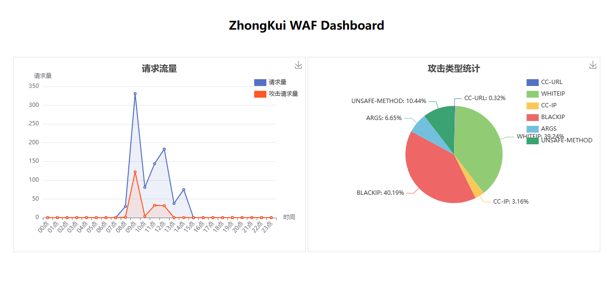

## ZhongKui-WAF

钟馗是中国传统文化中的一个神话人物，被誉为“捉鬼大师”，专门驱逐邪恶之物。`Zhongkui-WAF`的命名灵感来源于这一神话人物，寓意着该软件能够像钟馗一样，有效地保护Web应用免受各种恶意攻击和威胁。

`Zhongkui-WAF`基于`lua-nginx-module`，可以多维度检查和拦截恶意网络请求，具有简单易用、高性能、轻量级的特点。它的配置简单，你可以根据实际情况设置不同的安全规则和策略。

  

### 主要特性

+ 多种工作模式，可随时切换
    1. 关闭模式：放行所有网络请求
    2. 保护模式（protection）：拦截攻击请求并记录攻击日志
    3. 监控模式（monitor）：记录攻击日志但不拦截攻击请求
+ 支持规则自动排序，开启后按规则命中次数降序排序，可提高拦截效率
+ 支持ACL自定义规则，灵活配置拦截规则
+ 支持站点独立配置
+ IP黑名单、白名单，支持IPv6及网段配置，"127.0.0.1/24"或"127.0.0.1/255.255.255.0"
+ HTTP Method白名单
+ URL黑名单、白名单
+ URL恶意参数拦截
+ 恶意Header拦截
+ 请求体检查
+ 上传文件类型白名单（默认只允许常见图片/文档/压缩包/音视频/字体），并拦截双扩展名与危险类型，防止webshell上传
+ 恶意Cookie拦截
+ CC攻击拦截
+ 人机验证，验证失败后可以自动限时或永久拉黑IP地址
+ Sql注入、XSS、SSRF等攻击拦截
+ 可设置仅允许指定国家的IP访问
+ 敏感数据（身份证号码、手机号码、银行卡号、密码）脱敏及关键词过滤
+ 支持Redis，开启后IP请求频率、IP黑名单等数据将从Redis中读写，实现集群效果
+ 攻击日志记录，包含IP地址、IP所属地区、攻击时间、防御动作、拦截规则等，支持JSON格式日志
+ 流量统计可视化

### 上传文件类型白名单

`fileExt` 采用白名单模式：`conf/global_rules/fileExt.json` 中 `state=on` 的 `rule` 表示允许的扩展名，未命中即拦截。升级时请整体替换该文件，不要沿用旧版的黑名单配置。站点级 `conf/sites/<站点ID>/rules/fileExt.json` 如果由升级流程用新版文件逐站点覆盖，则无需额外处理；只有升级后仍保留旧版站点级文件时，才需要按白名单语义重写或删除。

校验行为：

+ 同时校验 `filename` 和 RFC 5987 `filename*`，任一候选名不合规即拦截
+ 文件名只接受 basename，兼容 IE 的 `C:\fakepath\` 前缀；绝对路径、UNC、相对路径一律拒绝
+ 拦截双扩展名、可执行扩展名、无扩展名、有内容但文件名为空、NUL/控制字符、NTFS ADS、RFC 2047 编码文件名，以及多重百分号编码后的危险值
+ 重复/折叠 `filename`、`filename` 出现在 `Content-Type`、嵌套 `multipart/*`、非法 boundary、缺失/重复/逗号合并的 `Content-Type` 等解析歧义，按异常请求拦截
+ 文件内容始终经过 Post 规则检查；`fileContentCheck` 开启后再追加 libinjection 检测。含二进制 NUL 的内容跳过文本规则
+ 同时检查 `X-Filename`、`X-File-Name`、`X-Upload-Filename` 请求头中的文件名
+ 上传拦截日志中的上下文截断到 2 KB 并移除换行，避免整段请求体写入日志

### 安装

可以执行安装脚本`install.sh`，自动安装`OpenResty`、`ZhongKui`、`libmaxminddb`、`luafilesystem`和`geoipupdate`。也可以自行逐个安装。

#### OpenResty

由于`Zhongkui-WAF`基于`lua-nginx-module`，所以要先安装`Nginx`或`OpenResty`，强烈推荐使用`OpenResty`。

如果你使用`Nginx`，则需要安装以下第三方模块：

1. 安装`LuaJIT`和`lua-nginx-module`模块
2. 下载[lua-resty-redis库](https://github.com/openresty/lua-resty-redis)到`path-to-zhongkui-waf/lib/resty`目录
3. 安装[lua-cjson库](https://kyne.au/%7Emark/software/lua-cjson.php)

#### zhongkui-waf

假设`OpenResty`安装路径为：`/usr/local/openresty`，下载`zhongkui-waf`文件并放置在`/usr/local/openresty/zhongkui-waf`目录。

修改`nginx.conf`，在`http`模块下添加`zhongkui-waf`相关配置：

```nginx
include /usr/local/openresty/zhongkui-waf/admin/conf/waf.conf;
include /usr/local/openresty/zhongkui-waf/admin/conf/admin.conf;
include /usr/local/openresty/zhongkui-waf/admin/conf/sites.conf;
```

可根据访问量大小适当调整`waf.conf`文件中配置的字典内存大小。

```nginx
lua_shared_dict dict_cclimit 10m;
lua_shared_dict dict_captcha 16m;
lua_shared_dict dict_accesstoken 5m;
lua_shared_dict dict_blackip 10m;
lua_shared_dict dict_locks 100k;
lua_shared_dict dict_config 100k;
lua_shared_dict dict_config_rules_hits 100k;
lua_shared_dict dict_req_count 5m;
lua_shared_dict dict_req_count_citys 10m;
lua_shared_dict dict_sql_queue 10m;

lua_package_path "/usr/local/openresty/zhongkui-waf/?.lua;/usr/local/openresty/zhongkui-waf/lib/?.lua;/usr/local/openresty/zhongkui-waf/admin/lua/?.lua;;";
init_by_lua_file  /usr/local/openresty/zhongkui-waf/init.lua;
init_worker_by_lua_file /usr/local/openresty/zhongkui-waf/init_worker.lua;
access_by_lua_file /usr/local/openresty/zhongkui-waf/waf.lua;
body_filter_by_lua_file /usr/local/openresty/zhongkui-waf/body_filter.lua;
header_filter_by_lua_file /usr/local/openresty/zhongkui-waf/header_filter.lua;
log_by_lua_file /usr/local/openresty/zhongkui-waf/log_and_traffic.lua;
```

#### libmaxminddb库

IP地理位置识别需要下载MaxMind的IP地址数据文件及安装该IP数据文件的读取库。

1. 从MaxMind官网下载[GeoLite2 City](https://www.maxmind.com/en/accounts/current/geoip/downloads)数据文件，后续可使用[官方工具](https://github.com/maxmind/geoipupdate)对该数据文件自动更新。

2. 安装`libmaxminddb`库

    ```bash
    wget -P /usr/local/src https://github.com/maxmind/libmaxminddb/releases/download/1.7.1/libmaxminddb-1.7.1.tar.gz
    tar -zxvf libmaxminddb-1.7.1.tar.gz
    cd libmaxminddb-1.7.1
    ./configure
    make && make install
    echo /usr/local/lib >> /etc/ld.so.conf.d/local.conf
    ldconfig
    ```

    Windows系统用户要自行编译，生成`libmaxminddb.dll`文件，具体参考`maxmind/libmaxminddb`官方文档[using-cmake](https://github.com/maxmind/libmaxminddb#using-cmake)。

#### luaossl库

```bash
wget -O /usr/local/src/luaossl-rel-20220711.tar.gz https://github.com/wahern/luaossl/archive/refs/tags/rel-20220711.tar.gz
tar -zxf luaossl-rel-20220711.tar.gz
cd ./luaossl-rel-20220711
make all5.1 includedir=/usr/local/openresty/luajit/include/luajit-2.1 && make install5.1
```

#### LuaFileSystem库

```shell
wget -O /usr/local/src/luafilesystem-master.zip https://github.com/lunarmodules/luafilesystem/archive/refs/heads/master.zip
unzip luafilesystem-master.zip
cd ./luafilesystem-master
make INCS=/usr/local/openresty/luajit/include/luajit-2.1
mv ./src/lfs.so /usr/local/openresty/lualib/lfs.so
```

安装完成后重启`OpenResty`，使用测试命令：

```bash
curl http://localhost/?t=../../etc/passwd
```

看到拦截信息则说明安装成功。

#### Bot管理

##### bot陷阱

开启bot陷阱后，将会在上游服务器返回的HTML页面中添加配置的陷阱URL，这个URL隐藏在页面中，对普通正常用户不可见，访问此URL的请求被视为bot。

建议bot陷阱结合`robots协议`使用，将陷阱URI配置为禁止所有bot访问，不听话的bot将访问陷阱URL，从而被识别，而那些遵循`robots协议`的友好bot将不会被陷阱捕获。

你可以在robots.txt中这样配置：

```
User-agent: *
Disallow: /zhongkuiwaf/honey/trap
```

#### 敏感数据过滤

开启敏感信息过滤后，`Zhongkui-WAF`将对响应数据进行过滤。

`Zhongkui-WAF`内置了对响应内容中的身份证号码、手机号码、银行卡号、密码信息进行脱敏处理。需要注意的是，内置的敏感信息脱敏功能目前仅支持处理中华人民共和国境内使用的数据格式（如身份证号、电话号码、银行卡号），暂不支持处理中国境外的身份证号、电话号码、银行卡号等数据格式。但你可以使用正则表达式配置不同的规则，以过滤请求响应内容中任何你想要过滤掉的数据。

### 反向代理、CDN 与真实 IP

WAF 的 IP 相关功能（白名单、黑名单、CC、geoip、攻击日志）统一使用 nginx 的 `$remote_addr`：

- WAF nginx 直接对外时，`$remote_addr` 就是真实客户端 IP。
- WAF 前面有 CDN 或反向代理时，请在 nginx 中配置 realip 模块，只信任代理/CDN 的地址段：

```nginx
set_real_ip_from 10.0.0.0/8;
set_real_ip_from 192.168.0.0/16;
real_ip_header X-Forwarded-For;
real_ip_recursive on;
```

配置后 nginx 会把 `$remote_addr` 还原为客户端 IP，WAF 各部分和日志使用同一个值。不要把 `X-Forwarded-For`、`X-Real-IP` 等请求头直接当作客户端 IP：这些头可以被客户端伪造，直接使用会导致日志记录错误，并让黑名单、CC、geoip 失效。源站防火墙也应只允许 CDN/代理网段访问，避免攻击者绕过代理直连源站。

### 管理页面

安装配置完成后，浏览器访问`http://localhost:1226`，账号`admin`，默认密码为`zhongkui`。

`v1.2`版本开始，一些数据统计依赖`Mysql`数据库，因此需要配置`Mysql`数据库并自行创建database(`zhongkui_waf`)，waf启动后，表结构会自动创建。

### 常见问题

一个常见问题是：用安装脚本安装后无法产生日志，在管理界面修改配置项，无法保存或可以保存但必须手动执行`nginx -s reload`才能生效，这些都是因为`nginx`默认是用`nobody`用户启动的，而`nobody`用户没有对日志目录和钟馗目录下的文件读写权限。

请确保`Openresty`对`zhongkui-waf`目录和`OpenResty`日志目录（`\logs\hack`），有读、写权限，否则`WAF`会无法修改配置文件和生成日志文件。最佳实践是：新建一个`nginx`用户，并将这个`nginx`用户添加到sudoers，允许其执行`nginx`命令，然后将`zhongkui-waf`目录所属用户改为`nginx`用户，最后修改`nginx`配置文件，以`nginx`用户启动`nginx`。

```shell
# 添加nginx用户
sudo useradd nginx
# 使用sudo visudo命令将下面这行规则添加进去，将nginx用户添加到sudoers，仅允许其执行nginx命令
# nginx ALL=NOPASSWD: /usr/local/openresty/nginx/sbin/nginx
# 修改zhongkui-waf和日志目录归属用户
sudo chown -R nginx:nginx /usr/local/openresty/zhongkui-waf
sudo chown -R nginx:nginx /usr/local/openresty/nginx/logs/hack
```

修改`nginx.conf`：

```nginx
user nginx;
```

你也可以用root用户启动nginx，但不推荐。

### 交流群

欢迎大家进群交流，如果遇到bug或有新的需求，请优先提交Issues。

QQ群：903430639

### 捐赠

如果你觉得这个项目还不错，点击[这里](https://afdian.net/a/bukale)或扫描下方二维码为作者买杯咖啡吧！


### Copyright and License

ZhongKui-WAF is licensed under the Apache License, Version 2.

Copyright 2023 bukale bukale2022@163.com

Licensed under the Apache License, Version 2.0 (the "License");
you may not use this file except in compliance with the License.
You may obtain a copy of the License at

    http://www.apache.org/licenses/LICENSE-2.0

Unless required by applicable law or agreed to in writing, software
distributed under the License is distributed on an "AS IS" BASIS,
WITHOUT WARRANTIES OR CONDITIONS OF ANY KIND, either express or implied.
See the License for the specific language governing permissions and
limitations under the License.

